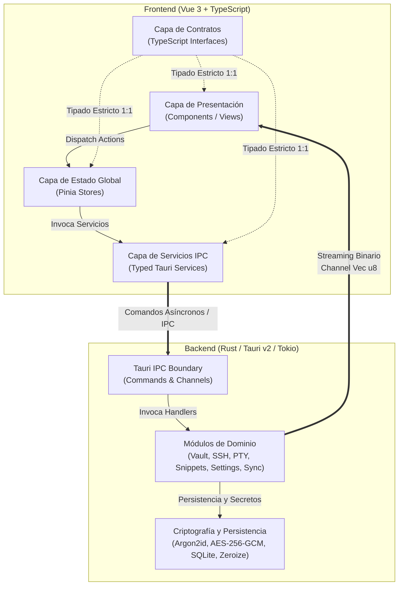

# NexusTerm — Guía de Arquitectura y Referencia Técnica

Este documento define la arquitectura oficial, los patrones de diseño, los contratos entre capas y las reglas inmutables de desarrollo para **NexusTerm**. Su propósito es servir como la **fuente de referencia técnica definitiva** para cualquier desarrollador o agente de IA que colabore en el proyecto, garantizando alta cohesión, bajo acoplamiento, escalabilidad a largo plazo y cero código "parchado".

---

## 1. Visión y Principios Fundamentales

NexusTerm está diseñado bajo tres pilares fundamentales:
1. **Rendimiento Nativo y Cero Desperdicio de RAM**: Uso de Rust (Tokio) y Tauri v2 en lugar de entornos Electron pesados.
2. **Seguridad y Cero Conocimiento (*Zero-Knowledge by Design*)**: Ningún secreto, clave privada o passphrase se almacena en texto plano en disco ni se retiene en memoria más tiempo del estrictamente necesario.
3. **Arquitectura por Capas y Dominios Aislados (*Domain-Driven Layered Architecture*)**: Tanto el backend como el frontend se dividen en dominios autocontenidos con fronteras de responsabilidad explícitas.

---

## 2. Mapa Arquitectónico General



---

## 3. Arquitectura del Backend (Rust / Tokio / Tauri v2)

El código de Rust reside en `src-tauri/src/` y está organizado por **módulos de dominio**.

```text
src-tauri/src/
├── vault/            # Criptografía, SQLite, Gestión de Bóveda e Inventario
│   ├── crypto.rs     # Primitivas criptográficas (Argon2id, AES-256-GCM, Zeroize)
│   ├── db.rs         # Inicialización, migraciones SQLite y estado de la bóveda
│   └── inventory.rs  # CRUD de Carpetas, Servidores (Hosts) e Identidades
├── ssh/              # Motor SSH, Multiplexación y Sesiones Interactivas
│   └── mod.rs        # russh client, PTY channels, known_hosts y SSH Agent
├── pty/              # Terminal Local del Sistema Operativo
│   └── mod.rs        # portable-pty (Bash, Zsh, Fish, PowerShell)
├── settings/         # Configuración y Preferencias del Usuario (app_settings)
│   └── mod.rs        # Serialización de temas, atajos y opciones de terminal
├── snippets/         # Biblioteca de Comandos e Historial
│   └── mod.rs        # Persistencia y plantillas de comandos interactivos
├── ssh_config/       # Parser e Importador de ~/.ssh/config y known_hosts
├── session.rs        # Orquestación de sesiones de terminal y generación de llaves
└── lib.rs            # Application Wiring, Setup, Injection y Registro de Comandos
```

### 3.1. Inyección de Dependencias y Estado de la Aplicación
- Los administradores de estado (`VaultManager`, `PtySessionManager`, `SshSessionManager`) se crean una sola vez en el `setup` de `lib.rs` envueltos en `Arc<T>` y se gestionan mediante `app.manage()`.
- Los comandos de Tauri acceden al estado mediante `tauri::State<'_, Arc<Manager>>`.
- **Regla**: Ninguna función fuera de `VaultManager` abre conexiones directas a SQLite ni ejecuta consultas manuales.

### 3.2. Multiplexación de Canales SSH
NexusTerm no abre múltiples conexiones TCP si un host utiliza terminal, SFTP y telemetría simultáneamente.
- **Un único socket TCP/SSH autenticado** sirve para múltiples canales lógicos:
  1. **PTY Interactivo**: Tráfico de terminal.
  2. **Subsistema SFTP**: `russh-sftp` para transferencia y exploración de archivos.
  3. **Canal de Telemetría**: Ejecución periódica no invasiva de métricas (`/proc/stat`, `df`, etc.).
  4. **Canales Direct-TCPIP**: Port Forwarding Local y Dinámico (SOCKS5).

### 3.3. Seguridad Criptográfica y Zero-Knowledge
- **Derivación de Clave Maestra**: Argon2id con parámetros de alta seguridad (64 MiB RAM, 3 iteraciones, 4 hilos en paralelo).
- **Cifrado por Registro**: Cada registro confidencial (contraseñas, llaves SSH privadas, passphrases, notas) se cifra con una clave interna `VaultKey` envuelta usando AES-256-GCM y un nonce aleatorio de 96 bits.
- **Limpieza de Memoria Sensible**: Uso de `zeroize::Zeroize` en structs que almacenan claves criptográficas para sobrescribir la memoria RAM con ceros inmediatamente al bloquear la bóveda o cerrar la aplicación.

### 3.3.1. Sincronización con servidor propio (en construcción)
La sincronización con un servidor autoalojado es *zero-knowledge*: el servidor solo almacena sobres cifrados. Se construye por fases (`sync-foundations` → `sync-server` → `sync-client-engine` → `sync-ui` → `sync-hardening-docs`).
- **`crates/sync-proto`** (dependencia por ruta de `src-tauri`, sin red): sobre de registro versionado (AES-256-GCM con AAD `kind|id|rev|deleted`), jerarquía de claves (contraseña maestra + **Secret Key** → AUK → clave de autenticación y clave de envoltura mediante HKDF), **paquete de clave** con varias envolturas (`pwd`, `recovery`) y parámetros del KDF, **clave de recuperación** y texto del **kit de emergencia**. Comparte tipos con el futuro servidor.
- **`src-tauri/src/sync/`**: seguimiento local de cambios mediante disparadores SQLite (`sync_rev`, `sync_dirty`, `sync_tombstones`, `sync_state`) para carpetas, identidades, hosts, túneles y snippets propios; sellado y apertura de registros. El flag `sync_state.applying` evita reenviar lo que llega del servidor.
- El modelo de amenazas está en `docs/SYNC_THREAT_MODEL.md`.

### 3.4. Manejo de Errores Estructurado
- Prohibido el uso de `.unwrap()` o `.expect()` en rutas de red, I/O o criptografía.
- Cada módulo define su enum de errores con `thiserror` (ej. `VaultError`), serializable a JSON o cadena descriptiva hacia el frontend.

---

## 4. Arquitectura del Frontend (Vue 3 / TypeScript / Pinia)

El frontend sigue un flujo de datos **unidireccional estricto** dividido en 4 capas:

```text
src/
├── components/       # 1. CAPA DE PRESENTACIÓN (Vistas y Componentes UI)
│   ├── hosts/        # Árbol de inventario, modales de hosts, carpetas e identidades
│   ├── terminal/     # XtermView, contenedores de split panes, pestañas
│   ├── snippets/     # Panel de snippets y barra de Broadcast
│   ├── settings/     # Modal de configuración, atajos y personalización
│   └── vault/        # Pantalla y modal de desbloqueo/inicialización de bóveda
├── composables/      # Lógica reutilizable: useEnsureUnlocked, useIdleLock, useSessionRestore
├── stores/           # 2. CAPA DE ESTADO GLOBAL (Pinia Stores)
│   ├── vault.store.ts      # Bóveda, inventario de carpetas, hosts e identidades (bloquear conserva las sesiones)
│   ├── sessions.store.ts   # Pestañas, paneles divididos (split tree) y broadcast
│   ├── settings.store.ts   # Configuración de apariencia, fuente y terminal
│   └── snippets.store.ts   # Colección de snippets interactivos
├── services/         # 3. CAPA DE INFRAESTRUCTURA Y SERVICIOS IPC
│   ├── vault.service.ts
│   ├── inventory.service.ts
│   ├── session.service.ts
│   └── settings.service.ts
└── types/            # 4. CAPA DE CONTRATOS Y MODELOS DE DOMINIO
    ├── inventory.ts  # Interfaces reflejadas 1:1 con Rust
    ├── sessions.ts   # Estructuras de árboles de split panes y pestañas
    ├── settings.ts   # Estructuras de configuración
    └── themes.ts     # Definiciones de temas y paletas
```

### 4.0. Desbloqueo Bajo Demanda de la Bóveda
- La aplicación arranca con una terminal local sin pedir la contraseña maestra (salvo el ajuste `ask_password_on_startup`). `App.vue` ya no oculta el workspace tras `VaultUnlockScreen`.
- `useEnsureUnlocked()` es el único punto para pedir el desbloqueo: `ensureUnlocked()` abre `VaultUnlockModal` (carga perezosa) y comparte un solo modal entre llamadas simultáneas; `runWithUnlock(fn)` reintenta una vez si el backend responde con un error que contiene el código estable `VAULT_LOCKED:` (`isVaultLockedError` en `src/utils/vault-errors.ts`).
- El gate real sigue en el backend: solo los comandos que usan credenciales almacenadas llaman a `get_active_vault_key()`. Snippets, definiciones de túneles y ajustes no las contienen y no se bloquean.
- `lock()` borra la clave y las cachés sensibles, pero **no** cierra sesiones: las conexiones ya autenticadas no vuelven a consultar la bóveda.
- `useIdleLock()` bloquea tras `auto_lock_minutes` sin entrada del usuario (teclado, ratón, foco); la salida de las terminales no cuenta.
- `useSessionRestore` restaura sin bóveda las pestañas solo locales; si el layout tiene hosts, aplaza la oferta al primer desbloqueo (aviso no modal) y no guarda nada hasta resolverla.

### 4.1. Reglas de Separación de Capas en el Frontend
1. **Componentes (UI)**:
   - Solo contienen lógica visual y reactividad local de plantilla.
   - Despachan acciones a los **Stores de Pinia** o consultan getters.
   - **Regla**: Queda terminantemente prohibido invocar `invoke()` de Tauri directamente desde un componente `.vue`. Toda comunicación con el backend pasa por un Servicio o Store.
2. **Stores (Pinia)**:
   - Son los únicos dueños del estado global mutable.
   - Coordinan llamadas asíncronas hacia la capa de Servicios y actualizan las variables reactivas (`ref`).
3. **Servicios (`services/`)**:
   - Clientes tipados que encapsulan los nombres literales de comandos de Tauri (`invoke("nombre_comando", payload)`).
   - Manejan canales binarios `Channel<Vec<u8>>` y transforman buffers si es necesario.
4. **Contratos (`types/`)**:
   - Interfaces puras en TypeScript. Mantienen sincronización estricta con los structs de Rust.

### 4.2. Streaming Binario en la Terminal
- Para evitar la penalización de rendimiento de serializar JSON en cada tecla o salida de comando (`stdout`), el backend envía fragmentos binarios `Vec<u8>` mediante `tauri::ipc::Channel`.
- El frontend recibe arrays `Uint8Array` e invoca directamente `terminal.write(chunk)`, permitiendo tasas de refresco de 60+ FPS sin saturar el bucle de eventos de JavaScript.

### 4.3. Carga Asíncrona (Lazy Loading) y Eficiencia de Memoria
- **Regla Estricta**: Toda funcionalidad nueva, modal, drawer, diálogo de confirmación, visor auxiliar (ej. visores gráficos VNC/RDP, exploradores SFTP, editores) o panel que no forme parte del arranque esencial (`VaultUnlockScreen`, `TerminalWorkspace`, `HostTreeSidebar`) debe cargarse asíncronamente mediante `defineAsyncComponent`.
- Esto asegura la división de código (*code splitting*) en Vite, reduce el bundle inicial y previene la asignación innecesaria de heap en el proceso `WebKitWebProcess` de WebKitGTK al iniciar la aplicación.


### 4.3. Tokens de Diseño Reactivos (Theming System)
- La aplicación implementa temas completos (Obsidian, Cyberpunk, Nord, Solarized Dark, High Contrast) utilizando tokens de CSS reactivos (`--color-theme-app`, `--color-theme-surface`, `--color-theme-accent`, etc.) mapeados a clases semánticas de Tailwind CSS v4 (`bg-theme-app`, `text-theme-accent`, `border-theme`).
- Ningún componente debe escribir colores fijos hexadecimales o clases arbitrarias que rompan la coherencia entre temas.

---

## 5. Guía Práctica: Cómo Añadir una Nueva Funcionalidad

Para mantener la arquitectura limpia y predecible, todo nuevo módulo debe implementarse siguiendo este flujo ordenado:

1. **Especificación previa (SDD / OpenSpec)**:
   - Crear propuesta, especificaciones delta, diseño técnico y lista de tareas con `openspec new change "<nombre>"`.
2. **Backend (Rust)**:
   - Si es un dominio nuevo, crear `src-tauri/src/<dominio>/mod.rs`.
   - Definir modelos y métodos de servicio.
   - Exponer comandos en Tauri con atributos `#[tauri::command]`.
   - Escribir pruebas unitarias (`#[cfg(test)]`) verificando la lógica de negocio.
   - Registrar los nuevos comandos en el `invoke_handler![]` de `src-tauri/src/lib.rs`.
3. **Frontend (TypeScript / Vue)**:
   - Crear o extender la interfaz de datos en `src/types/<dominio>.ts`.
   - Implementar el cliente tipado en `src/services/<dominio>.service.ts`.
   - Integrar el estado y acciones en `src/stores/<dominio>.store.ts` con su respectivo test unitario (`.test.ts`).
   - Crear o actualizar los componentes visuales en `src/components/<dominio>/` usando tokens `theme-*`.
4. **Validación Integral**:
   - Ejecutar `cargo test` en backend (debe pasar al 100%).
   - Ejecutar `vitest run`, `vue-tsc --noEmit` y `vite build` en frontend (cero errores).
   - Validar especificaciones con `openspec validate --all --strict`.

---

## 6. Política de Pruebas y Aseguramiento de Calidad

| Capa | Herramienta | Alcance | Comando de Verificación |
|---|---|---|---|
| **Backend** | Rust `cargo test` | Criptografía, SQLite, inventario, parsers, sesiones | `cd src-tauri && cargo test` |
| **Frontend State** | Vitest (`vitest run`) | Tiendas Pinia, temas, algoritmos de split pane | `pnpm test` o `./node_modules/.bin/vitest run` |
| **Frontend Types** | `vue-tsc` | Comprobación estricta de tipos TypeScript | `./node_modules/.bin/vue-tsc --noEmit` |
| **Frontend Bundle** | Vite Build | Empaquetado estático de producción | `./node_modules/.bin/vite build` |
| **Especificaciones** | OpenSpec CLI | Validación formal de requisitos y cambios | `openspec validate --all --strict` |
