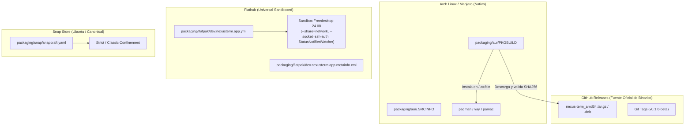

# Diseño Técnico: Empaquetado y Distribución para Linux (AUR, Flatpak y Snap)

## 1. Visión General de la Arquitectura de Distribución

NexusTerm utiliza una arquitectura basada en Rust y WebKitGTK empaquetada con Tauri v2. Para integrarse limpiamente en las diversas distribuciones de Linux sin generar conflictos de bibliotecas ni comprometer la seguridad del sistema, se diseñan tres canales de distribución:



---

## 2. Estructura de Archivos del Proyecto

```text
packaging/
├── aur/
│   ├── PKGBUILD                  # Receta de empaquetado para Arch/Manjaro
│   ├── .SRCINFO                  # Metadatos generados para el AUR
│   └── dev.nexusterm.app.desktop # Lanzador XDG para el menú de aplicaciones
├── flatpak/
│   ├── dev.nexusterm.app.yml     # Manifiesto Flathub
│   └── dev.nexusterm.app.metainfo.xml # Metadatos AppStream (Discover / GNOME Software)
└── snap/
    └── snapcraft.yaml            # Manifiesto para Snap Store

scripts/
└── update-aur.sh                 # Automatización de cálculo de hashes y regeneración de .SRCINFO
```

---

## 3. Especificación de Sandbox y Permisos (Flatpak)

Para que NexusTerm funcione con todas sus características (multiplexación SSH, túneles, SFTP, telemetría y bandeja del sistema KDE) dentro del sandbox de Flatpak, el manifiesto `dev.nexusterm.app.yml` declara:

```yaml
app-id: dev.nexusterm.app
runtime: org.freedesktop.Platform
runtime-version: '24.08'
sdk: org.freedesktop.Sdk
command: nexus-term
finish-args:
  # Renderizado gráfico
  - --socket=wayland
  - --socket=fallback-x11
  - --share=ipc
  - --device=dri
  # Conexiones de red (SSH, SFTP, Túneles de puertos y telemetría)
  - --share=network
  # Agente SSH del anfitrión
  - --socket=ssh-auth
  # Notificaciones e Icono de Bandeja del Sistema (KDE Plasma StatusNotifierItem)
  - --talk-name=org.freedesktop.Notifications
  - --talk-name=org.freedesktop.StatusNotifierWatcher
  # Ejecución de shell local (opcional para terminal local del anfitrión)
  - --talk-name=org.freedesktop.Flatpak
```

---

## 4. Especificación del Paquete AUR (`PKGBUILD`)

El paquete `nexus-term-bin` sigue las directrices oficiales del Arch Wiki:
- **`pkgname`**: `nexus-term-bin`
- **`pkgdesc`**: `Modern multiplatform SSH, SFTP, and terminal manager built with Tauri v2`
- **`arch`**: `('x86_64')`
- **`license`**: `('GPL-3.0-or-later')`
- **`depends`**: `('gtk3' 'webkit2gtk-4.1' 'libappindicator-gtk3' 'openssl')`
- **`provides`**: `('nexus-term')`
- **`conflicts`**: `('nexus-term')`

---

## 5. Script de Automatización de Versiones (`scripts/update-aur.sh`)

Permite actualizar la versión en el `PKGBUILD` sin errores humanos:
1. Recibe el nuevo tag de versión como argumento (ej. `v0.1.0-beta`).
2. Descarga el paquete de release correspondiente o calcula su hash `sha256sum`.
3. Actualiza las variables `pkgver`, `pkgrel=1` y `sha256sums` en `packaging/aur/PKGBUILD`.
4. Ejecuta `makepkg --printsrcinfo > packaging/aur/.SRCINFO`.

---

## 6. Cumplimiento de Licencias FOSS (GNU GPLv3)
- El código fuente y binarios de NexusTerm son GPLv3.
- El archivo AppStream se etiqueta con `<metadata_license>CC0-1.0</metadata_license>` y `<project_license>GPL-3.0-or-later</project_license>` según los estándares de Flathub y freedesktop.org.
