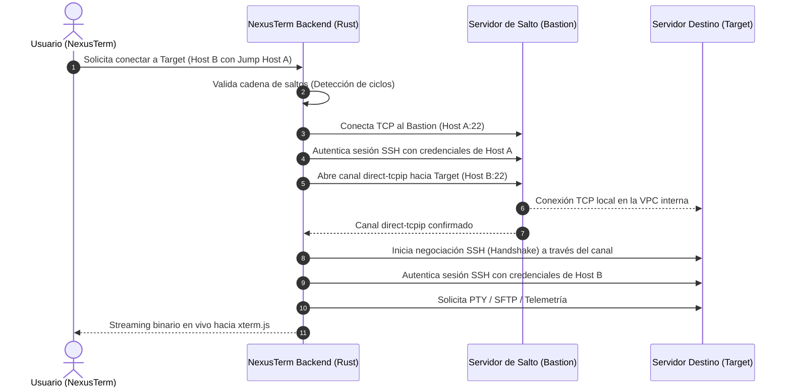

# Diseño Técnico: Servidores de Salto (Jump Hosts / Bastion Chaining)

## 1. Arquitectura y Flujo de Conexión Encadenada

El protocolo SSH permite abrir canales `direct-tcpip` a través de una sesión SSH autenticada existente. En NexusTerm, cuando un servidor destino tiene configurado un `jump_host_id`, el backend orquesta la conexión en dos etapas:



---

## 2. Esquema SQLite y Persistencia en Bóveda

Se agrega la columna `jump_host_id` a la tabla `hosts` en `src-tauri/src/vault/db.rs`:

```sql
ALTER TABLE hosts ADD COLUMN jump_host_id TEXT REFERENCES hosts(id) ON DELETE SET NULL;
```

### Struct Rust (`src-tauri/src/vault/inventory.rs`)
```rust
#[derive(Debug, Serialize, Deserialize, Clone, PartialEq)]
pub struct HostRecord {
    pub id: String,
    pub folder_id: Option<String>,
    pub identity_id: Option<String>,
    pub jump_host_id: Option<String>, // Nuevo campo
    pub name: String,
    pub hostname: String,
    pub port: u16,
    pub tags: Vec<String>,
    pub created_at: String,
    pub updated_at: String,
}
```

---

## 3. Algoritmo de Prevención de Ciclos (Cycle Detection)

Para evitar bucles infinitos en memoria durante la conexión (ej. `A -> B -> C -> A`), el backend implementa una validación recursiva en `src-tauri/src/vault/inventory.rs`:

```rust
pub fn check_jump_host_cycles(
    conn: &Connection,
    target_host_id: &str,
    candidate_jump_id: &str,
) -> Result<(), VaultError> {
    if target_host_id == candidate_jump_id {
        return Err(VaultError::ValidationError("Un host no puede ser su propio servidor de salto".into()));
    }
    
    let mut current = candidate_jump_id.to_string();
    let mut visited = HashSet::new();
    visited.insert(target_host_id.to_string());

    while let Some(next_jump) = get_jump_host_id_of(conn, &current)? {
        if visited.contains(&next_jump) {
            return Err(VaultError::ValidationError("Referencia circular detectada en la cadena de servidores de salto".into()));
        }
        visited.insert(next_jump.clone());
        current = next_jump;
    }

    Ok(())
}
```

---

## 4. Adaptación del Motor de Sesión SSH (`src-tauri/src/session.rs`)

`SshSessionManager::connect_ssh`:
1. Consulta si el host tiene un `jump_host_id`.
2. Si existe:
   - Resuelve el registro del Jump Host y su identidad descifrada.
   - Crea un cliente `russh` conectado al Jump Host.
   - Solicita un canal `channel_open_direct_tcpip(target.hostname, target.port, "127.0.0.1", 0)`.
   - Adapta el canal `ChannelStream` para que implemente `AsyncRead + AsyncWrite`.
   - Inicializa el cliente SSH del servidor destino utilizando este stream en lugar del socket TCP directo `TcpStream::connect`.
3. Si no existe:
   - Procede con la conexión directa estándar `TcpStream::connect`.

---

## 5. Frontend y Componentes UI

- **`src/types/inventory.ts`**: Adición de `jump_host_id?: string | null` en `Host` y `SaveHostPayload`.
- **`src/components/hosts/HostModal.vue`**:
  - Nuevo selector con icono de enlace `Network` o `Route`: *"Servidor de Salto / Bastion (Opcional)"*.
  - Lista desplegable con todos los hosts guardados en la bóveda, excluyendo el host actual.
- **`src/components/hosts/HostTreeSidebar.vue` & `QuickConnectModal.vue`**:
  - Badge visual `via [Nombre del Bastion]` junto a la etiqueta de IP o tags.
