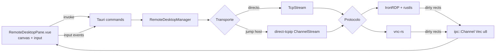

# Diseño Técnico: Acceso Gráfico VNC y RDP

## 1. Arquitectura



Módulo nuevo `src-tauri/src/remote_desktop/`: `mod.rs` (manager y comandos), `rdp.rs`, `vnc.rs`, `transport.rs`, `frame.rs`, `error.rs`. Cada sesión es una tarea Tokio con un `mpsc::Sender<InputEvent>` para entrada y un `Channel` para salida. El `ChannelStream` (`AsyncRead+AsyncWrite`) de jump hosts se reutiliza en `transport.rs`.

## 2. Esquema SQLite

```sql
ALTER TABLE hosts ADD COLUMN protocol TEXT NOT NULL DEFAULT 'ssh' CHECK (protocol IN ('ssh','rdp','vnc'));
ALTER TABLE hosts ADD COLUMN rdp_domain TEXT;           -- dominio NLA opcional
CREATE TABLE IF NOT EXISTS rdp_cert_fingerprints (      -- TOFU de certificados
  host_id TEXT PRIMARY KEY REFERENCES hosts(id) ON DELETE CASCADE,
  sha256 BLOB NOT NULL,                                 -- cifrado con VaultKey (AES-GCM)
  accepted_at TEXT NOT NULL
);
```
`HostSummary`/`SaveHostPayload` ganan `protocol: String` y `rdp_domain: Option<String>`; espejo en `src/types/inventory.ts` (`protocol: 'ssh' | 'rdp' | 'vnc'`).

## 3. Contratos IPC

| Comando | Entrada | Salida |
|---|---|---|
| `rd_connect` | `{ session_id, host_id, width, height, on_frame: Channel<InvokeResponseBody> }` | `{ session_id, protocol, unencrypted_warning }` |
| `rd_send_input` | `{ session_id, event: InputEvent }` | `()` |
| `rd_resize` | `{ session_id, width, height }` | `()` |
| `rd_send_cad` | `{ session_id }` | `()` |
| `rd_set_clipboard` | `{ session_id, text }` | `()` |
| `rd_accept_cert` | `{ session_id, accept }` | `()` |
| `rd_disconnect` | `{ session_id }` | `()` |

Eventos de ciclo de vida (JSON, bajo volumen): `rd://{session_id}/state` (`connecting|connected|disconnected|error`), `rd://{session_id}/clipboard`, `rd://{session_id}/cert-prompt`.

`InputEvent` (serde, tag `type`): `key{scancode,down}`, `pointer{x,y,buttons}`, `wheel{dx,dy}`.

### Formato binario del frame (little-endian)
`[u8 kind][u16 x][u16 y][u16 w][u16 h][RGBA w*h*4]`; `kind`: 0=rect, 1=resize completo (w,h nuevos, sin payload), 2=cursor (hotspot + RGBA). El frontend usa `new ImageData(new Uint8ClampedArray(buf, off, len), w, h)` + `putImageData`.

## 4. Decisiones clave
1. **IronRDP vs FreeRDP**: IronRDP es Rust puro, permisivo, sin FFI; coste: menos funciones (sin redirección de unidades en esta fase). Aceptado.
2. **Canvas 2D en lugar de WebGL**: simplicidad y `putImageData` parcial; se mide en el spike (tarea 1.2) y se revisa si >30 ms/frame a 1080p.
3. **Coalescencia**: un buffer de rectángulos sucios por sesión; el emisor envía como máximo a ~60 Hz uniendo rects solapados (backpressure).
4. **Teclado**: usar `KeyboardEvent.code` → scancode (RDP) / keysym (VNC) con tabla en `src/utils/keymap.ts`; capturar teclas solo con foco en el canvas.
5. **Credenciales**: se descifran en Rust únicamente al conectar, en `Zeroizing<String>`; nunca llegan al frontend ni a `tracing`.
6. **TLS RDP**: `rustls` con verificador propio (TOFU) en vez de CA del sistema, porque los servidores Windows usan certificados autofirmados.
7. **Portapapeles**: solo texto (CLIPRDR / ClientCutText); conmutador `remote_desktop.clipboard` en Settings (por defecto activado).

## 5. Seguridad
- Sin secretos en logs; mensajes de error sanitizados.
- VNC sin cifrado: advertir en UI y sugerir Jump Host/SSH cuando el host no tenga `jump_host_id` y no sea loopback.
- Límite de tamaño de rect/frame para evitar DoS por servidor malicioso (validar `w*h*4` ≤ framebuffer).

## 6. Frontend
- `src/services/remote-desktop.service.ts`, `src/stores/remote-desktop.store.ts` (sesiones, estado, escala), `src/utils/keymap.ts`.
- `src/components/remote/RemoteDesktopPane.vue`, `RemoteToolbar.vue`, `CertPromptModal.vue`.
- `sessions.store.ts`: nuevo `kind: 'terminal' | 'remote-desktop'` por pestaña.
- `HostModal.vue`: selector de protocolo (CustomSelect), campo dominio RDP; ocultar opciones SSH-only (tunnels/SFTP) según protocolo.

## 7. Estrategia de pruebas
Rust: parser/serializador de frames, mapeo de input, coalescencia, migración y validación de `protocol`, transporte con servidor VNC/RDP simulado (tokio duplex). Vitest: store, keymap, decodificador de frames, filtrado por protocolo en inventario.

## 8. Ajustes surgidos durante la implementación
- **`session_id` generado por el frontend**: así puede suscribirse a `rd://{id}/event` *antes* de llamar a `rd_connect` y no perder los primeros eventos (p. ej. un fallo inmediato). El backend valida el alfabeto (`[A-Za-z0-9_-]`, ≤ 64) y rechaza ids duplicados.
- **Frames binarios reales**: `Channel<Vec<u8>>` serializa como array JSON de números (lento para frames de varios MB). Se usa `Channel<InvokeResponseBody>` con `InvokeResponseBody::Raw`, que llega al frontend como `ArrayBuffer`.
- **Huella de certificado RDP**: se guarda como hex SHA-256 en texto plano (`rdp_cert_fingerprints.sha256_hex`). Es un hash público, no un secreto; el cifrado por registro previsto inicialmente no aporta confidencialidad.
- **TOFU de certificado interactivo**: la conexión TLS ya está establecida cuando se pide la decisión, por lo que el usuario acepta/rechaza (`rd_accept_cert`) sin reconectar y *antes* de enviar credenciales (CredSSP ocurre después del TLS). Timeout de 120 s.
- **Ejecución de sesiones**: los futures de IronRDP (`connect_finalize` usa closures async) no cumplen `Send` de forma general, por lo que cada sesión corre con `block_on` en un hilo del pool bloqueante en lugar de `tokio::spawn`.
- **`vnc-rs`**: `recv_event` retiene el mutex del cliente mientras espera, bloqueando el envío de entrada; se usa `poll_event` con un tick de 16 ms (que además sirve de intervalo de volcado). Se omite la codificación Tight para no recibir JPEG.
- **Dependencias**: se usan los subcrates `ironrdp-*` directamente (el metacrate `ironrdp 0.17` fija versiones antiguas incompatibles entre sí) y `x509-cert 0.3` + `ironrdp-tls` (rustls). Todas MIT/Apache-2.0; el árbol transitivo (≈800 paquetes) solo contiene licencias permisivas, y MPL-2.0 (cssparser, selectors; vía Tauri), compatible con GPLv3.

## 9. Pendiente de esta iteración (tarea 2.7b)
Portapapeles de texto RDP (CLIPRDR) y redimensionado dinámico por Display Control (requiere gestionar la secuencia de reactivación). Mientras tanto, RDP usa el tamaño del panel al conectar y escalado en el cliente; VNC cumple ambos requisitos. El portapapeles VNC sí está implementado.
